# MatTO

**Joint material and topology optimization of stimulus-responsive soft materials**

[](https://github.com/CEADpx/matto/actions/workflows/ci.yml)
[](https://ceadpx.github.io/matto)
[](https://doi.org/10.5281/zenodo.22761145)
[](LICENSE.txt)

MatTO designs structures and materials simultaneously made of soft materials that deform or stiffen when a stimulus is applied: a magnetic field, heat, or light. Given a domain, loads, a stimulus and a goal, it finds **where material should be** (`rho`), **where the active material should go** (`phi`), and **how that material should be oriented** (`theta`), by nonlinear finite-element analysis, adjoint sensitivities and the optimization solvers.

The optimization is written once and knows nothing about the material. A material is a short class that declares its design fields and stimuli and returns a free-energy density; the package differentiates it for the stress and the sensitivities. Four material families and eleven worked problems, in 2D and 3D, serial and MPI-parallel, are included in the repository. It is built on [FEniCSx](https://fenicsproject.org/) and extended from [FEniTop](https://github.com/missionlab/fenitop). Documentation: [ceadpx.github.io/matto](https://ceadpx.github.io/matto).

<picture><source media="(prefers-color-scheme: dark)" srcset="docs/assets/demo/hMSM_morphing_dome_3d_dark.gif">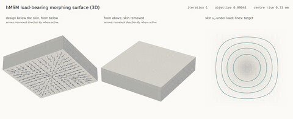</picture>
*A slab with a solid skin, clamped on its sides, designed so that a magnetic field along its thickness raises the skin into a dome and holds that shape under load. MatTO designs the structure below the skin, where the magnetic particles go, and the direction of their magnetization, all at once. Left and centre: the material that remains, coloured by magnetic content. Right: the skin's rise against the target's contour lines.*

## Examples

Every example below is an input script in [`examples/`](examples/). Left: the problem. Right: the design over the iterations, the final frame being the optimized design. Colour shows the amount of material, from none (the background) to full; marks on the active-material field show its orientation.

### Hard-magnetic soft materials

A particle-reinforced hyperelastic matrix with a magnetic potential energy that is linear in the applied flux density. `phi` is the magnetic particle fraction and `theta` the direction of the remanent magnetization. The examples follow the joint material–structural framework of Galloway and Jha [2].

<table>
<tr>
<td width="42%"><picture><source media="(prefers-color-scheme: dark)" srcset="docs/assets/demo/hMSM_morphing_dome_3d_setup_dark.png">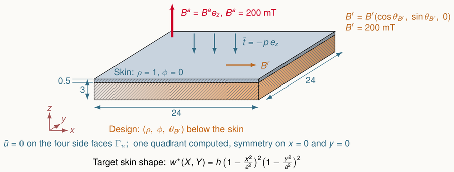</picture></td>
<td width="58%"><picture><source media="(prefers-color-scheme: dark)" srcset="docs/assets/demo/hMSM_morphing_dome_3d_dark.gif"></picture></td>
</tr>
<tr>
<td colspan="2"><b>Load-bearing morphing surface, 3D</b> · <a href="examples/hMSM/input_morphing_dome_3d.py"><code>input_morphing_dome_3d.py</code></a><br>Designs <code>rho</code>, <code>phi</code> and <code>theta</code> below a solid, non-magnetic skin so that the skin forms a 1 mm dome under a 200 mT field and holds it under 0.5 kPa. One quadrant is modeled, with symmetry conditions on its two inner faces, and the skin is held in all three fields. After 500 iterations the centre of the skin rises 0.986 mm, with a root-mean-square error of 0.005 mm against the target. The magnetization is kept cell-wise and unfiltered, since filtering an angle that turns once around the centre leaves a line where it points the wrong way.</td>
</tr>
<tr>
<td width="42%"><picture><source media="(prefers-color-scheme: dark)" srcset="docs/assets/demo/hMSM_restorative_beam_setup_dark.png">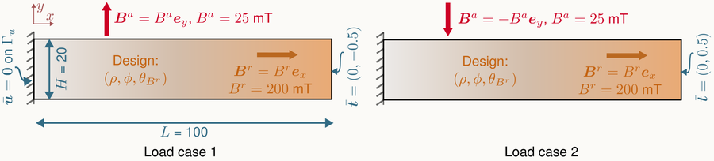</picture></td>
<td width="58%"><picture><source media="(prefers-color-scheme: dark)" srcset="docs/assets/demo/hMSM_restorative_beam_dark.gif">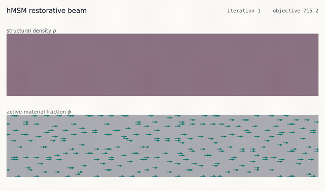</picture></td>
</tr>
<tr>
<td colspan="2"><b>Restorative beam</b> · <a href="examples/hMSM/input_beam.py"><code>input_beam.py</code></a><br>Designs all three fields under two opposing load cases, so that the beam carries the traction and the field restores it toward its undeformed shape.</td>
</tr>
<tr>
<td width="42%"><picture><source media="(prefers-color-scheme: dark)" srcset="docs/assets/demo/hMSM_rotational_wheel_setup_dark.png">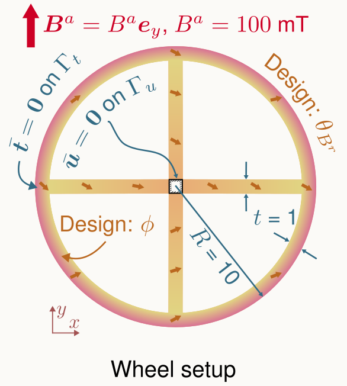</picture></td>
<td width="58%"><picture><source media="(prefers-color-scheme: dark)" srcset="docs/assets/demo/hMSM_rotational_wheel_dark.gif">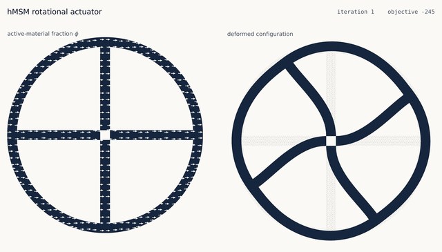</picture></td>
</tr>
<tr>
<td colspan="2"><b>Rotational actuator</b> · <a href="examples/hMSM/input_wheel.py"><code>input_wheel.py</code></a><br>Designs <code>phi</code> and <code>theta</code> in a fixed wheel to turn the rim counterclockwise about the clamped hub.</td>
</tr>
<tr>
<td width="42%"><picture><source media="(prefers-color-scheme: dark)" srcset="docs/assets/demo/hMSM_translational_scissor_setup_dark.png">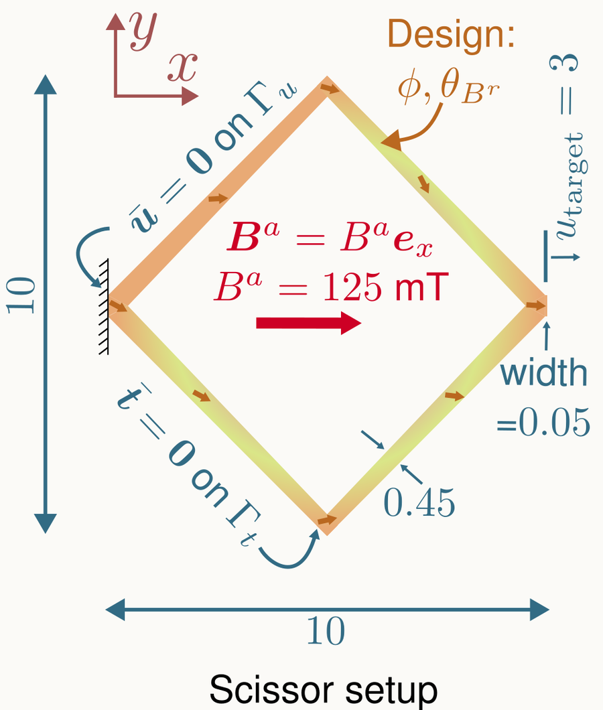</picture></td>
<td width="58%"><picture><source media="(prefers-color-scheme: dark)" srcset="docs/assets/demo/hMSM_translational_scissor_dark.gif">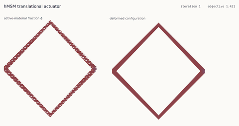</picture></td>
</tr>
<tr>
<td colspan="2"><b>Translational actuator</b> · <a href="examples/hMSM/input_scissor.py"><code>input_scissor.py</code></a><br>Designs <code>phi</code> and <code>theta</code> in a fixed frame to move its free corner by a target distance along x without moving it along y.</td>
</tr>
</table>

### Liquid crystal elastomers

The model of Barrera et al. [5] couples the strain to a prescribed drop in the nematic order parameter. `phi` selects programmed, active LCE against passive LCE and `theta` is the director. Activation is prescribed; no thermal or optical field is solved.

<table>
<tr>
<td width="42%"><picture><source media="(prefers-color-scheme: dark)" srcset="docs/assets/demo/LCE_morphing_strip_setup_dark.png">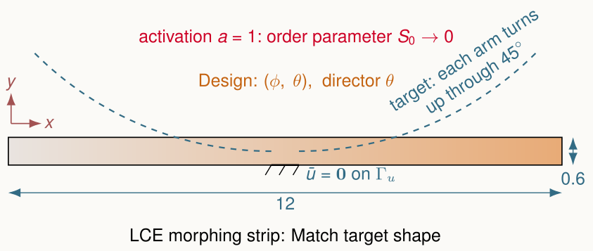</picture></td>
<td width="58%"><picture><source media="(prefers-color-scheme: dark)" srcset="docs/assets/demo/LCE_morphing_strip_dark.gif">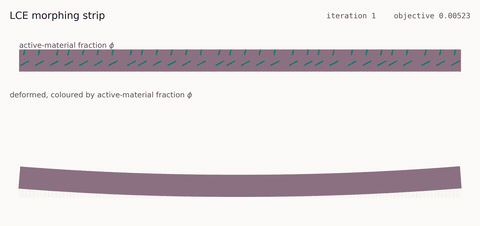</picture></td>
</tr>
<tr>
<td colspan="2"><b>Morphing strip</b> · <a href="examples/Barrera2024_LCE/input_morphing_strip.py"><code>input_morphing_strip.py</code></a><br>Designs <code>phi</code> and <code>theta</code> so that a flat strip held at its centre curls into a U, each arm turning up through 45 degrees.</td>
</tr>
<tr>
<td width="42%"><picture><source media="(prefers-color-scheme: dark)" srcset="docs/assets/demo/LCE_pusher_setup_dark.png">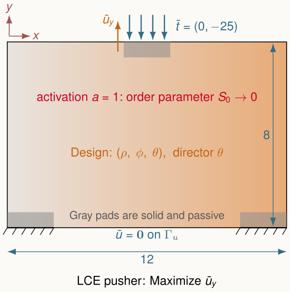</picture></td>
<td width="58%"><picture><source media="(prefers-color-scheme: dark)" srcset="docs/assets/demo/LCE_pusher_dark.gif">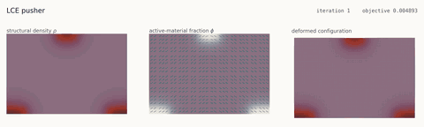</picture></td>
</tr>
<tr>
<td colspan="2"><b>Pusher</b> · <a href="examples/Barrera2024_LCE/input_pusher.py"><code>input_pusher.py</code></a><br>Designs all three fields to lift an output pad against a downward traction.</td>
</tr>
<tr>
<td width="42%"><picture><source media="(prefers-color-scheme: dark)" srcset="docs/assets/demo/LCE_vertical_extension_setup_dark.png">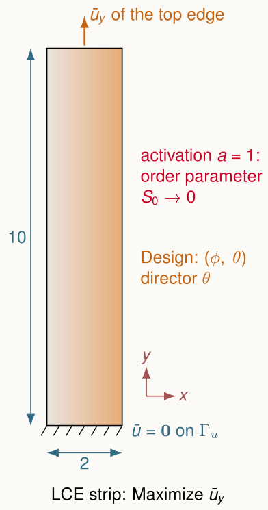</picture></td>
<td width="58%"><picture><source media="(prefers-color-scheme: dark)" srcset="docs/assets/demo/LCE_vertical_extension_dark.gif">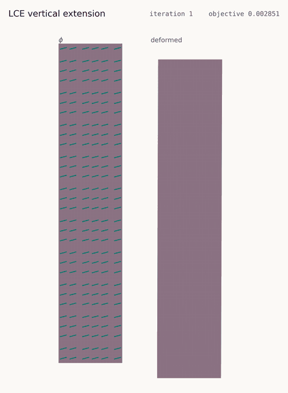</picture></td>
</tr>
<tr>
<td colspan="2"><b>Vertical extension</b> · <a href="examples/Barrera2024_LCE/input_vertical_extension.py"><code>input_vertical_extension.py</code></a><br>Designs <code>phi</code> and <code>theta</code> in a clamped strip to raise its top edge.</td>
</tr>
</table>

### Magneto-active elastomers

Two models that stiffen under a magnetic field of magnitude `h`: the anisotropic, particle-chain model of Akbari and Khajehsaeid [3], where `theta` is the chain direction and the stiffening depends on its alignment with the field, and the isotropic model of Garai and Haldar [4]. `phi` mixes the active elastomer with plain silicone.

<table>
<tr>
<td width="42%"><picture><source media="(prefers-color-scheme: dark)" srcset="docs/assets/demo/MAE_aniso_bridge_setup_dark.png"></picture></td>
<td width="58%"><picture><source media="(prefers-color-scheme: dark)" srcset="docs/assets/demo/MAE_aniso_bridge_dark.gif">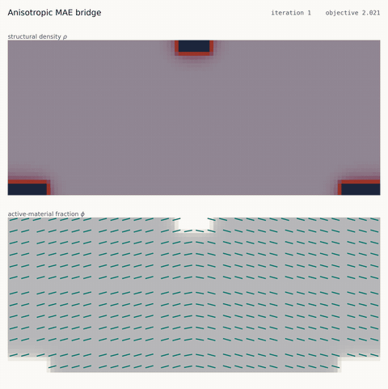</picture></td>
</tr>
<tr>
<td colspan="2"><b>Anisotropic bridge</b> · <a href="examples/Akbari2021_MAE/input_bridge.py"><code>input_bridge.py</code></a><br>Designs all three fields to minimize the compliance of a bridge on two supports.</td>
</tr>
<tr>
<td width="42%"><picture><source media="(prefers-color-scheme: dark)" srcset="docs/assets/demo/MAE_aniso_beam_setup_dark.png">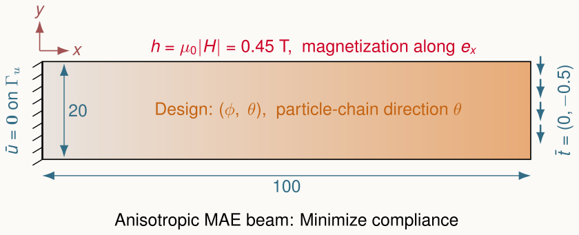</picture></td>
<td width="58%"><picture><source media="(prefers-color-scheme: dark)" srcset="docs/assets/demo/MAE_aniso_beam_dark.gif">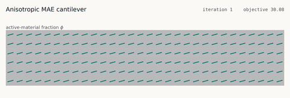</picture></td>
</tr>
<tr>
<td colspan="2"><b>Anisotropic cantilever</b> · <a href="examples/Akbari2021_MAE/input_beam.py"><code>input_beam.py</code></a><br>Designs <code>phi</code> and <code>theta</code> in a solid cantilever to minimize its compliance with the field on.</td>
</tr>
<tr>
<td width="42%"><picture><source media="(prefers-color-scheme: dark)" srcset="docs/assets/demo/MAE_iso_bridge_setup_dark.png">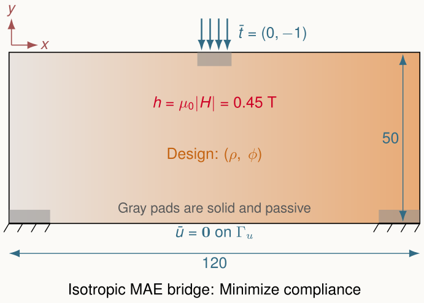</picture></td>
<td width="58%"><picture><source media="(prefers-color-scheme: dark)" srcset="docs/assets/demo/MAE_iso_bridge_dark.gif">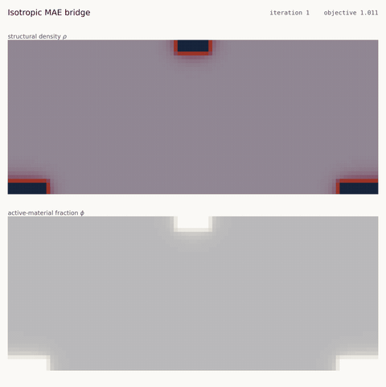</picture></td>
</tr>
<tr>
<td colspan="2"><b>Isotropic bridge</b> · <a href="examples/Garai2025_MAE/input_bridge.py"><code>input_bridge.py</code></a><br>Designs <code>rho</code> and <code>phi</code> to minimize the compliance of the same bridge.</td>
</tr>
<tr>
<td width="42%"><picture><source media="(prefers-color-scheme: dark)" srcset="docs/assets/demo/MAE_iso_beam_setup_dark.png">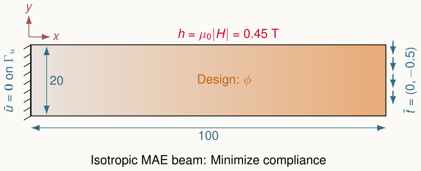</picture></td>
<td width="58%"><picture><source media="(prefers-color-scheme: dark)" srcset="docs/assets/demo/MAE_iso_beam_dark.gif">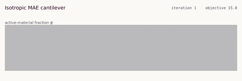</picture></td>
</tr>
<tr>
<td colspan="2"><b>Isotropic cantilever</b> · <a href="examples/Garai2025_MAE/input_beam.py"><code>input_beam.py</code></a><br>Designs <code>phi</code> in a solid cantilever to minimize its compliance with the field on.</td>
</tr>
</table>

[`examples/linear_elastic/`](examples/linear_elastic/) holds 2D and 3D compliance-minimization cantilevers set up like FEniTop's, so the two codes can be compared.

## What the package provides

- Nonlinear, quasi-static finite-element analysis in 2D and 3D, with load stepping, in FEniCSx
- An optimization workflow that is independent of the material model
- Any combination of structural density, material distribution and local orientation as design fields, each optimized or prescribed
- Several load cases, each with its own loads and stimuli, under one objective
- Helmholtz filtering, Heaviside projection with continuation, and fixed design regions, composed as a chain of operators per field
- Adjoint sensitivities for objectives and constraints, checked against finite differences in the tests
- Method of Moving Asymptotes (MMA) design updates
- Compliance, displacement, displacement-tracking, shape-tracking and rotation objectives in the examples
- MPI parallelism, tested at 1, 2 and 4 ranks
- Postprocessors that follow a run: an iteration history, design snapshots, pictures in 2D and 3D, and the design saved when a solve fails
- ParaView-readable BP4 output

| Field | Role | In the examples |
| --- | --- | --- |
| `rho` (ρ) | Structural material density | Solid–void topology |
| `phi` (ϕ) | Composition or active-material distribution | Magnetic particle fraction, active against passive LCE, MAE against silicone |
| `theta` (θ) | Local material orientation | Remanent magnetization, particle-chain direction, LCE director |

## Quick start

The supplied Conda environment targets Linux, WSL and macOS, with Python 3.13 and FEniCSx/DOLFINx 0.9.0.

```bash
git clone https://github.com/CEADpx/matto.git
cd matto
conda env create -f environment.yml
conda activate matto

PYTHONPATH=src python examples/Barrera2024_LCE/input_morphing_strip.py          # serial
PYTHONPATH=src mpirun -n 4 python examples/hMSM/input_morphing_dome_3d.py       # parallel
```

The output directory is set by `output_options` in each input script. A completed run writes:

- `optimized_design_<load_case>.bp/`: ParaView-readable BP4 results for each load case
- `final_<variable>_raw.npy` and `final_<variable>_phys.npy`: the final design before and after filtering and projection
- `final_results.txt`: final objective, constraints and maximum displacements

To watch a run, add postprocessors to the problem:

```python
from matto import HistoryWriter, SnapshotPlotter

problem["postprocessors"] = [
    HistoryWriter(),                                   # history.csv, one row per iteration
    SnapshotPlotter(every=10, direction="theta", weight="phi"),   # arrays and a picture every 10 iterations
]
```

`SnapshotPlotter` draws each field in 2D and, in 3D, the material above a density threshold seen from chosen camera angles. Subclass it and override `draw()` for a picture of your own, as [`input_morphing_dome_3d.py`](examples/hMSM/input_morphing_dome_3d.py) does.

## Defining a problem

An input script assembles one `problem` dictionary and hands it to `OptimizationDriver`. It supplies:

1. A mesh, boundary conditions, loads, and load cases with their stimuli
2. The design fields: which are optimized, their bounds, initial values, operators and fixed regions
3. A material, for example `HardMagneticSoftMaterial(**material_parameters)`
4. Objective and constraint forms in UFL
5. Requested output fields and, optionally, postprocessors
6. Solver settings for the state, adjoint and filter problems, and MMA settings

```python
from matto import OptimizationDriver
OptimizationDriver(problem).run()
```

The closest existing example is the right starting point; [Writing an input file](https://ceadpx.github.io/matto/inputs.html) describes every entry.

### Adding a material

Subclass `matto.materials.Material`, declare the fields and stimuli it reads and its parameters, and write its free-energy density:

```python
class MyMaterial(Material):
    fields = ("rho", "phi")
    stimuli = {"h": ()}
    parameters = {"G": None, "p_rho": 3.0}

    def energy(self, F, fields, stimuli):
        ...
        return W
```

`check_material()` tests a new model for a stress-free reference state and frame indifference. Stimulus names and shapes are collected from the load cases and checked against what the material declares, so a new model needs no change to the optimization code. The four families live in [`src/matto/materials/`](src/matto/materials/).

## Repository structure

```text
MatTO
├── docs                  Sphinx documentation and README assets
├── environment.yml
├── examples
│   ├── Akbari2021_MAE    anisotropic magneto-active elastomer
│   ├── Barrera2024_LCE   liquid crystal elastomer
│   ├── Garai2025_MAE     isotropic magneto-active elastomer
│   ├── hMSM              hard-magnetic soft material, 2D and 3D
│   └── linear_elastic    comparison with FEniTop
├── src/matto
└── tests
```

- **[`driver.py`](src/matto/driver.py):** `OptimizationDriver`, the optimization loop: continuation, load-case solves, sensitivities, MMA updates, convergence, output, and the postprocessor hooks.
- **[`state.py`](src/matto/state.py):** `StateProblem`, the material-independent nonlinear finite-element problem in 2D and 3D.
- **[`design.py`](src/matto/design.py):** `DesignVariable` and the operator chain (Helmholtz filter, Heaviside projection) that maps raw design fields to physical ones and carries sensitivities back.
- **[`sensitivity.py`](src/matto/sensitivity.py):** objective and constraint derivatives by direct terms and nonlinear adjoint solves.
- **[`materials/`](src/matto/materials/):** the `Material` contract, the models (`hmsm`, `lce`, `mae`, `mae_aniso`, `linear`), shared kinematics and interpolation, and `check_material`.
- **[`postprocess.py`](src/matto/postprocess.py):** `PostProcessor`, `HistoryWriter`, `DesignSnapshots` and `SnapshotPlotter`.
- **[`mma.py`](src/matto/mma.py):** the MMA implementation, from FEniTop.
- **[`utility.py`](src/matto/utility.py):** the nonlinear solver wrapper and MPI gather helpers.

## Testing

```bash
python -m pip install pytest
python -m pytest                                  # serial suite
mpirun -n 2 python -m pytest                      # the same under MPI
mpirun -n 1 python -m pytest -m examples          # every example for one iteration
mpirun -n 2 python -m pytest -m examples
mpirun -n 4 python -m pytest -m examples
```

The suite checks the adjoint sensitivities against finite differences in 2D and 3D, the operator chain, the material models, the MMA calling convention, the postprocessors, and the first objective of every example against its recorded value at 1, 2 and 4 ranks.

## Scope

The analysis is nonlinear and quasi-static. Applied magnetic fields and LCE activation are prescribed inputs; the repository does not solve separate electromagnetic, thermal or optical field equations. Of the material models, the hard-magnetic soft material runs in 2D and 3D; the LCE and MAE models are plane strain. In 3D the remanent magnetization lies in the x-y plane, set by one angle, and the applied field may point anywhere. The implementations are intended for research and should be checked for the units, dimensional assumptions and parameter ranges of a new application.

## References

1. Y. Jia, C. Wang, and X. S. Zhang, “FEniTop: a simple FEniCSx implementation for 2D and 3D topology optimization supporting parallel computing,” *Structural and Multidisciplinary Optimization*, 67, 140 (2024). [https://doi.org/10.1007/s00158-024-03818-7](https://doi.org/10.1007/s00158-024-03818-7)

2. I. Galloway and P. K. Jha, “Model-Informed Joint Material-Structural Optimization of Hard-Magnetic Soft Materials,” arXiv:2607.14397 (2026). [https://doi.org/10.48550/arXiv.2607.14397](https://doi.org/10.48550/arXiv.2607.14397)

3. E. Akbari and H. Khajehsaeid, “A continuum magneto-mechanical model for magnetorheological elastomers,” *Smart Materials and Structures*, 30, 015008 (2021). [https://doi.org/10.1088/1361-665X/abc72f](https://doi.org/10.1088/1361-665X/abc72f)

4. A. Garai and K. Haldar, “Experiments and modeling of magneto-stiffening effects for magnetoactive polymer,” *International Journal of Mechanical Sciences*, 286, 109860 (2025). [https://doi.org/10.1016/j.ijmecsci.2024.109860](https://doi.org/10.1016/j.ijmecsci.2024.109860)

5. J. L. Barrera, C. Cook, E. Lee, K. Swartz, and D. A. Tortorelli, “Liquid Crystal Orientation and Shape Optimization for the Active Response of Liquid Crystal Elastomers,” *Polymers*, 16, 1425 (2024). [https://doi.org/10.3390/polym16101425](https://doi.org/10.3390/polym16101425)

## Citing this repository

If you use MatTO, please cite the software and the publication associated with the material model used in your study.

```bibtex
@article{galloway2026topology,
  author       = {Galloway, Ian and
                  Jha, Prashant K},
  title        = {Model-Informed Joint Material-Structural    
                  Optimization of Hard-Magnetic Soft 
                  Materials
                  },
  month        = jul,
  year         = 2026,
  journal      = {arXiv preprint arXiv:2607.14397},
  doi          = {10.48550/arXiv.2607.14397},
  url          = {https://arxiv.org/abs/2607.14397},
}


@software{galloway2026matto,
  author       = {Galloway, Ian and
                  Jha, Prashant K},
  title        = {CEADpx/matto - Joint material and topology
                   optimization of stimulus-responsive soft materials
                  },
  month        = sep,
  year         = 2026,
  publisher    = {Zenodo},
  doi          = {10.5281/zenodo.22761145},
  url          = {https://doi.org/10.5281/zenodo.22761145},
}
```

## Acknowledgments

MatTO began as a fork of [FEniTop](https://github.com/missionlab/fenitop) by Yingqi Jia, Chao Wang, and Xiaojia Shelly Zhang. Its MMA solver, the parallel gather in `utility.py`, and the filter and projection kernels in `design.py` are FEniTop's; the rest was written by Ian Galloway and Prashant K. Jha for nonlinear, stimulus-responsive, and multimaterial optimization. `NOTICE` gives the account file by file.
